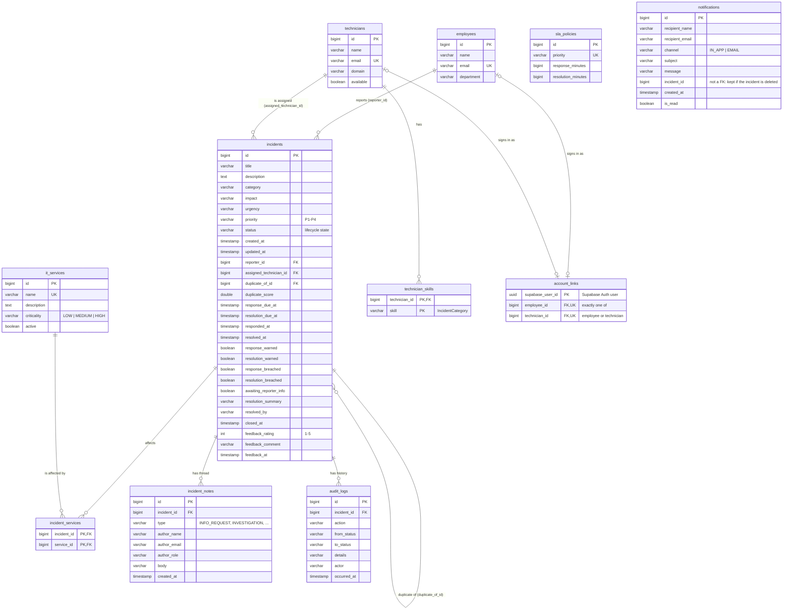

# I-ITSM Entity-Relationship Diagram

Matches the JPA entities and `schema.sql` + `account-links.sql` + `backend-additions.sql`.

## Important relationships

- **Inheritance:** `User` is a JPA `@MappedSuperclass`, so `employees` and `technicians` are separate tables with the same `name`/`email` columns.
- **Incident is the aggregate root.** Notes and audit entries belong to one incident and are deleted with it (`ON DELETE CASCADE`).
- **Many-to-many:** an incident affects one or more IT services through `incident_services`.
- **Self-reference:** a duplicate points at the original incident (`duplicate_of_id`), always the root, never another duplicate.
- **Sign-in:** `account_links` maps a Supabase (Google) user to exactly one employee or technician. Administrators are configured by user id (`ITSM_ADMIN_USER_IDS`) and have no row.
- `sla_policies` is keyed by priority; the SLA deadlines are copied onto each incident when it is created, so changing a policy affects new incidents only.
